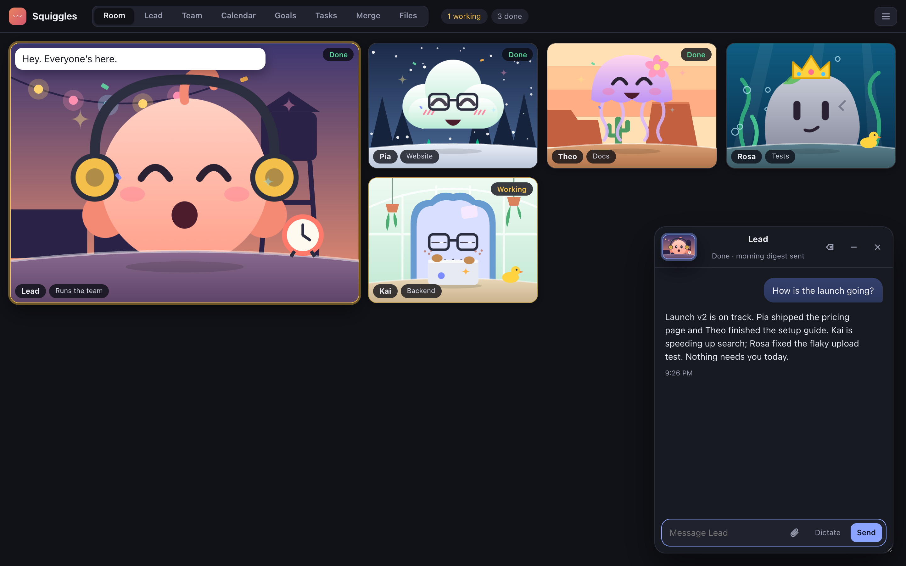

# Squiggles

A room for a small team of Claude Code agents. Each squiggle owns one area, wakes on a schedule, keeps a journal and works from a shared task board. You talk to the lead; the lead hires, briefs and checks the rest.



A fresh room has only the lead. It asks your name and what you work on, turns that into goals, and proposes the first hires.

## Requirements

- macOS
- Node 20 or newer
- [Claude Code](https://claude.com/claude-code), logged in (`claude` on your PATH)
- Optional: Google Chrome (draws the app icon), Tailscale (share the room on your tailnet), cloudflared (`brew install cloudflared`: share a public link without Tailscale), the pi CLI (squiggles on Pi models), the Cursor CLI `cursor-agent` (squiggles on Cursor models)

Every wake is a Claude Code session and counts against your plan's usage.

## Set up with Claude Code

Paste this into Claude Code:

> Set up Squiggles for me. Clone https://github.com/kidGodzilla/squiggles.git to ~/squiggles (pull if it already exists). Check that `node --version` is 20 or newer and `claude` is on my PATH; stop and tell me if not. Run `bash ~/squiggles/bin/install-app.sh`, which adds Squiggles.app and a login item that keeps the server running. Wait until http://127.0.0.1:4327 answers (port is in ~/.squiggles/config.json), then open it. Tell me to say hello to the lead.

## Set up by hand

```sh
git clone https://github.com/kidGodzilla/squiggles.git ~/squiggles
cd ~/squiggles
bash bin/install-app.sh            # Squiggles.app + login item
open http://127.0.0.1:4327
```

To try it without a login item: `node server.mjs`, then open the URL it prints.

Later, open the room from Spotlight ("Squiggles"). Server log: `~/Library/Logs/squiggles.log`.

## Where things live

| | |
|---|---|
| `~/squiggles` | the code; `upgrade` updates it (below) |
| `~/.squiggles` | your room: `config.json`, squiggles, charters, journals, board (override with `SQUIGGLES_HOME`) |

`config.json` settings: `port`, `userName`, `tailnet` (show "Share on tailnet"), `cloudflare` (show "Share on the internet": a public Cloudflare link, needs a room passcode of 8+ characters), `model` (`opus` or `sonnet`), `codex` (allow Codex models), `pi` (Pi models a squiggle may run on, as pi names them, e.g. `["provider/model"]`; needs the pi CLI with its own keys), `piExtensions` (pi extensions to load, e.g. one that adds a provider), `cursor` (Cursor models a squiggle may run on, as `cursor-agent` names them; needs the Cursor CLI signed in, and its Downloads/Desktop/Documents fence added once with `node ~/squiggles/cursor/install.mjs`, which your own Cursor ignores), `fileSources` (extra read-only folders for `files`, e.g. `{"notes": "~/notes"}`). Restart after editing: `node ~/squiggles/bin/agents.mjs restart`.

The lead and you share one CLI: `node ~/squiggles/bin/agents.mjs` (run it with no arguments for usage).

## Upgrade

**Security:** versions before 0.1.1 accept commands from any web page open in your browser. Upgrade now (below).

Paste this into Claude Code:

> Upgrade Squiggles: run `node ~/squiggles/bin/agents.mjs upgrade`. If it refuses because of local changes, move each change into a seam from ~/squiggles/docs/upgrading.md, then run it again. Summarise the changes it printed for me.

It pulls the new code, restarts the login item and migrates your room, backing it up first. Customise through the seams in [docs/upgrading.md](docs/upgrading.md) so upgrades never conflict.

## Uninstall

```sh
launchctl bootout gui/$(id -u)/local.squiggles.server
rm ~/Library/LaunchAgents/local.squiggles.server.plist
rm -rf ~/Applications/Squiggles.app ~/squiggles
rm -rf ~/.squiggles               # your room: charters, journals, board
```

## License

Apache-2.0. Parts of the room UI and voice setup are adapted from agent-standup (MIT); see [THIRD-PARTY-NOTICES.md](THIRD-PARTY-NOTICES.md).
